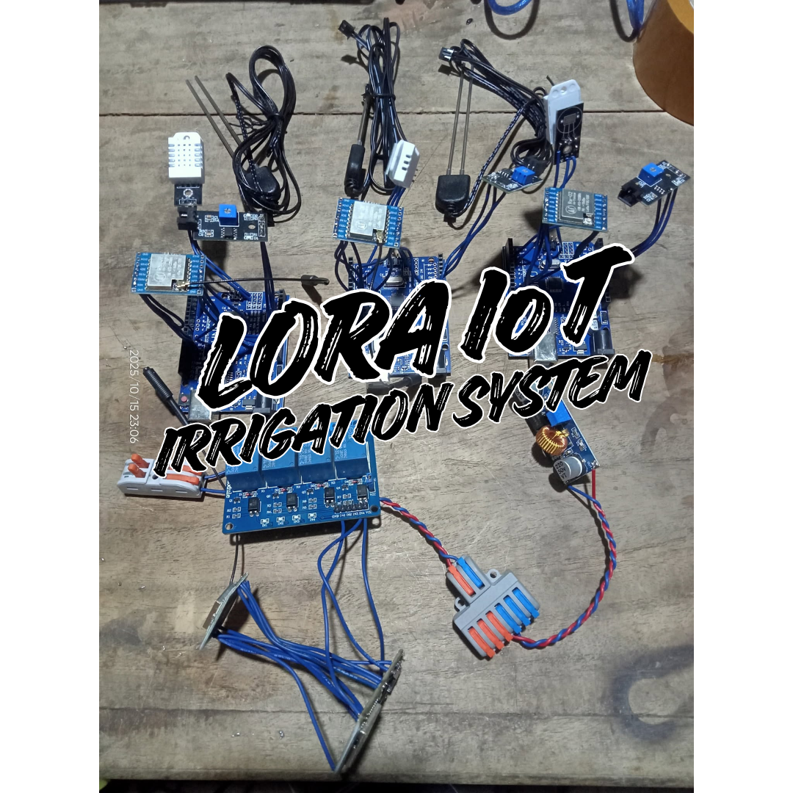
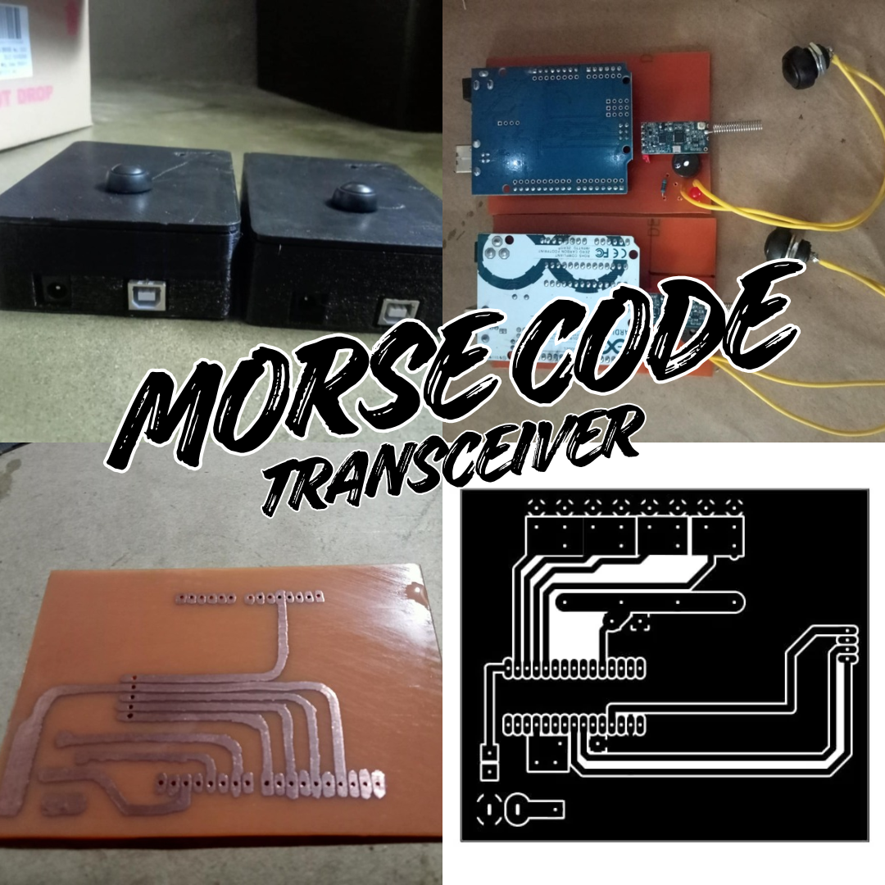

# Hi 👋, I'm Jay Four Javier

<h1 align="center">Jay Four Javier

  

</h1>
<h3 align="center">Freelance Prototype Fabricator since 2023 | 50+ Thesis Prototype Projects</h3>

  I design, fabricate, and develop engineering prototypes for students and clients in agriculture, engineering, and technology.

  <a href="#prototype-fabrication-projects"><strong>↓ Explore My Projects</strong></a>

---

## Personal Achievements

- 🏆 Consistent Top 1 student from Grade 1 to 12
- 📰 **Editor-in-Chief** of the school paper during high school
- 🎓 Studied **B.S. Agriculture and Biosystems Engineering** at [Tarlac Agricultural University](https://tau.edu.ph)
- 🌱 Awarded **Outstanding Young Farmer for Organic Agriculture (2020)** of Central Luzon
- 📺 Featured in agriculture magazines, television segments, and radio interviews as a Young Farmer

### Media Features

1. **Department of Agriculture – Central Luzon** — *Ani at Kita sa Agrikultura* ([Watch here](https://youtu.be/GLW9Sl_vmag))
2. **Department of Agriculture – Central Luzon** — *Ulat Gitnang Luzon Newsletter* ([Read here](https://drive.google.com/file/d/1n_NH8X28C6LVWRNF1k2uHzogq0azUO5K/view?usp=sharing))
3. **Tarlac Agricultural University - ELIA** — *Stories of Sustainability* ([Watch here](https://youtu.be/3xamapn8hfU))
4. **Department of Agriculture – PhilMech** — *Anihan Magazine* ([Read online](https://www.philmech.gov.ph/resources/anihan-magazine/2022%201st%20Issue.pdf))

### TESDA National Certificate Holder

- Organic Agriculture Production (NC II)
- Shielded Metal Arc Welding (NC I)
- Shielded Metal Arc Welding (NC II)
- Gas Tungsten Arc Welding (NC II)

[Verify TESDA certification](https://t2mis.tesda.gov.ph/Learners/S/6C004900660055004D004C004200430055006A006A0048004F00380071004E0061006A0034006B00390077003D003D00)

---

## Skills

- **Embedded Systems:** Arduino, ESP32, ESP8266, Raspberry Pi
- **Electronics:** PCB design, fabrication, soldering, assembly, and troubleshooting
- **CAD and Fabrication:** 2D/3D CAD design, 3D printing, welding, and metal fabrication
- **Programming:** Object-Oriented Programming (OOP), embedded C/C++, Python
- **Software Development:** Web, desktop, and mobile applications
- **Technical Drafting:** SketchUp, AutoCAD, SolidWorks

---

## Technologies Used

| Category | Technologies |
| --- | --- |
| Microcontrollers and Computing | Arduino, ESP32, ESP8266, Raspberry Pi |
| Programming and Web | C++, Python, HTML5, CSS3, JavaScript, PHP, Markdown |
| Databases | MySQL, Firebase |
| AI and Machine Learning | Edge Impulse, TensorFlow Lite, OpenCV, YOLO |
| Development Tools | VS Code, PlatformIO, Tinkercad, EasyEDA |
| CAD and Design | SketchUp, AutoCAD, SolidWorks |

  
  
  
  
  
  
  
  

---

## Arduino Libraries

Here are some of the Arduino libraries I have developed and published on GitHub.

- [AD7746 Capacitive-to-Digital Converter](https://github.com/jayfourjavier/Arduino_AD7746)
- [Arduino Simple IO](https://github.com/jayfourjavier/ARDUINO-SIMPLE-IO)

---

## Prototype Fabrication Projects

Here are selected examples of my prototype fabrication and engineering projects. Some client projects remain confidential under non-disclosure agreements and will be published when permitted.

### 1. LoRa IoT Irrigation System

  

An **IoT-based smart irrigation system** that leverages LoRa (Long Range) technology for long-distance, low-power wireless communication to remotely monitor and control irrigation in rice fields.

Distributed [sensor nodes](https://github.com/jayfourjavier/LORA-ARDUINO-UNO-SENSOR-NODE) powered by Arduino Uno microcontrollers collect soil moisture, temperature, and humidity data and transmit readings via LoRa to a [central controller](https://github.com/jayfourjavier/LORA-ESP32-CONTROLLER-NODE) based on the ESP32. The controller processes the collected data to support irrigation decisions and automatically manages irrigation according to field conditions, helping improve water-use efficiency and reduce manual intervention.

**Key components:** Arduino Uno · ESP32 · LoRa · Environmental Sensors

### 2. HC-12 Morse Code Transceiver

  

An **Arduino Uno-based wireless Morse code transceiver** that uses HC-12 serial radio modules to transmit and receive Morse code messages wirelessly. It provides visual and audio feedback through an LED and buzzer, allowing users to send and interpret Morse code signals using light and sound.

The device features a **custom-etched PCB** designed to integrate the electronic components, with a **replaceable Arduino Uno and HC-12 wireless module** for easier maintenance, troubleshooting, and hardware upgrades. A **3D-printed enclosure** houses and protects the electronics, creating a compact, modular, and serviceable embedded system.

**Key components:** Arduino Uno · HC-12 · Custom-Etched PCB · LED · Buzzer · 3D-Printed Enclosure

[View Source Code and Documentation](https://github.com/jayfourjavier/HC12-MORSE-CODE-TRANSCIEVER)

---

  <a href="#top"><strong>↑ Back to Top</strong></a>

